# AgriSmart

An agriculture assistant for Indian farmers that works **by hand, by voice, and by plain
phone call**, in the farmer's own language. A farmer can ask a question out loud, photograph a
sick leaf, check today's mandi price, see which government schemes they qualify for, and get
weather and crop advice for their own farm.

> Everything shown by the app is read from a live database or a live data source. Nothing
> on a screen is hard-coded sample data.

---

## Contents

1. [What it does](#1-what-it-does)
2. [What makes it different](#2-what-makes-it-different)
3. [Architecture](#3-architecture)
4. [The AI models: accuracy and worst case](#4-the-ai-models-accuracy-and-worst-case)
5. [Voice and native-language support](#5-voice-and-native-language-support)
6. [Algorithms and design choices](#6-algorithms-and-design-choices)
7. [Performance, latency and load balancing](#7-performance-latency-and-load-balancing)
8. [Thread safety and concurrency](#8-thread-safety-and-concurrency)
9. [Security](#9-security)
10. [Run everything locally](#10-run-everything-locally)
11. [Check it in mobile view](#11-check-it-in-mobile-view)
12. [Install on a phone (APK)](#12-install-on-a-phone-apk)
13. [Admin dashboard (website)](#13-admin-dashboard-website)
14. [Deploy](#14-deploy)
15. [Testing](#15-testing)
16. [Repository layout](#16-repository-layout)
17. [Known limits (read this)](#17-known-limits-read-this)
18. [Licences and data sources](#18-licences-and-data-sources)

---

## 1. What it does

| Feature | How it works |
|---|---|
| **Sign-in (free)** | Farmers create an account with a phone number or e-mail and a **password of their own**; it is stored hashed in the database and works on the phone app and on the web. No SMS or e-mail service is needed. Admins sign in with e-mail + password. A one-time code (SMS or e-mail) is optional, for "forgot password". |
| **11 languages** | English, Hindi, Telugu, Tamil, Kannada, Malayalam, Marathi, Bengali, Gujarati, Punjabi, Odia. |
| **Voice assistant** | Press the microphone, speak, get a spoken answer in a male or female voice. |
| **Button-phone line** | A farmer with a basic phone calls a Twilio number and talks to the same assistant. |
| **Crop recommendation** | Soil (N, P, K, pH) + weather + the farmer's state and season. |
| **Yield prediction** | Expected tonnes per hectare with a low / likely / high range. |
| **Plant disease check** | Photo of a leaf, 38 disease classes across 14 crops. |
| **Pest check** | Photo of an insect, 12 pest classes. |
| **Mandi prices** | Live prices from Agmarknet (data.gov.in as backup), with history. |
| **Government schemes** | Filtered to what the farmer is eligible for, shown in their language. |
| **Weather** | Live from Open-Meteo, cached 30 minutes. |
| **Farming calendar** | Tasks planned from the crop and sowing date. |
| **Profit calculator** | Cost, expected yield and market price. |
| **Alerts** | Weather, price, outbreak and calendar alerts by push notification, SMS or phone call. |
| **Support chat** | Farmer to admin, with unread counts. |
| **Admin dashboard** | Farmers, farms, prices, schemes, support, notifications, model versions, voice sessions, system health. |

## 2. What makes it different

1. **It says "I am not sure" instead of guessing.** Image models only answer when their
   confidence is above a threshold measured on test data. A separate *subject gate* model
   first checks that the photo is a leaf or insect at all. On the test sets this cut false
   acceptance of the wrong kind of photo from 33 % to 2 %.
2. **Three ways to reach the same assistant.** Touchscreen app, voice in the app, and a
   voice call from a button phone. All three go through one router ("AgriBrain"), so
   answers are identical.
3. **Local knowledge, not just a classifier.** Crop advice blends the soil/climate model with
   the *regional prior*: how much of each crop is actually grown in the farmer's state and
   season (from government area statistics), then applies agronomic rules.
4. **Rules first, AI second.** Most questions ("price of onion?") are answered by a fast,
   deterministic, free NLU. A language model is called only when no rule matches, and it can
   be switched off entirely.
5. **Voice that survives outages.** If the main voice provider (Sarvam) runs out of credits,
   the system moves to Gemini for the same task, mapping the chosen voice by gender.
6. **Mixed-language aware.** Farmers mix English words into their own language, so the
   English lexicon is always applied together with the farmer's language.
7. **Honest numbers.** Section 4 reports worst-case behaviour (blur, dark, noise, off-topic
   photos), not only the best-case accuracy.

## 3. Architecture

> The diagrams below are drawn with Mermaid, which GitHub renders automatically. PNG copies of the
> main figures are in [docs/images/](docs/images). The full written report is in
> [docs/AgriSmart_Project_Documentation.pdf](docs/AgriSmart_Project_Documentation.pdf) (also as .docx).


*Layered view of the whole system. More detail: [docs/ARCHITECTURE.md](docs/ARCHITECTURE.md).*


* **Backend**: Python 3.12, FastAPI, SQLAlchemy (async), Alembic migrations, PostgreSQL.
* **Mobile**: Expo SDK 57, React Native 0.86, Expo Router, TanStack Query, i18next.
* **Admin**: Next.js 16, React 19.
* **ML**: XGBoost and MobileNetV3 exported to ONNX (int8 where accuracy allows).
* The API is **stateless**; any instance can serve any request, so it scales by adding copies.

### 3.1 Technology stack at a glance

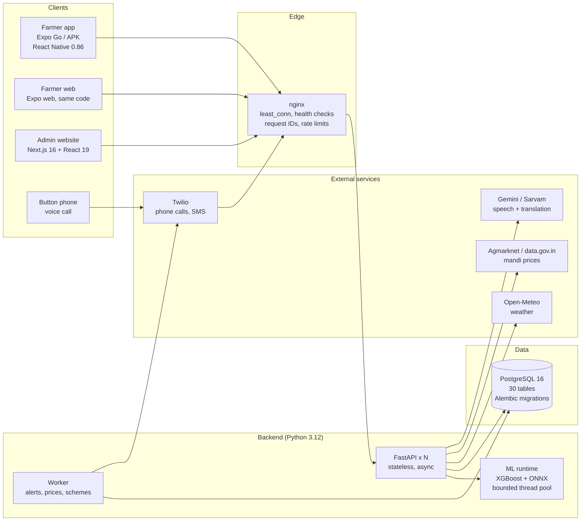

### 3.2 Life of one request

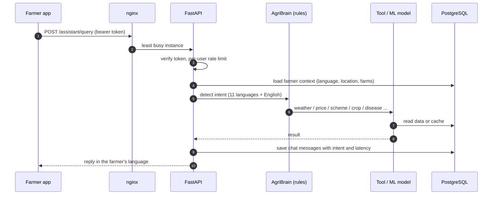

### 3.3 Database schema (30 tables)

Key tables and relationships. The full column list is in the report, section 7.

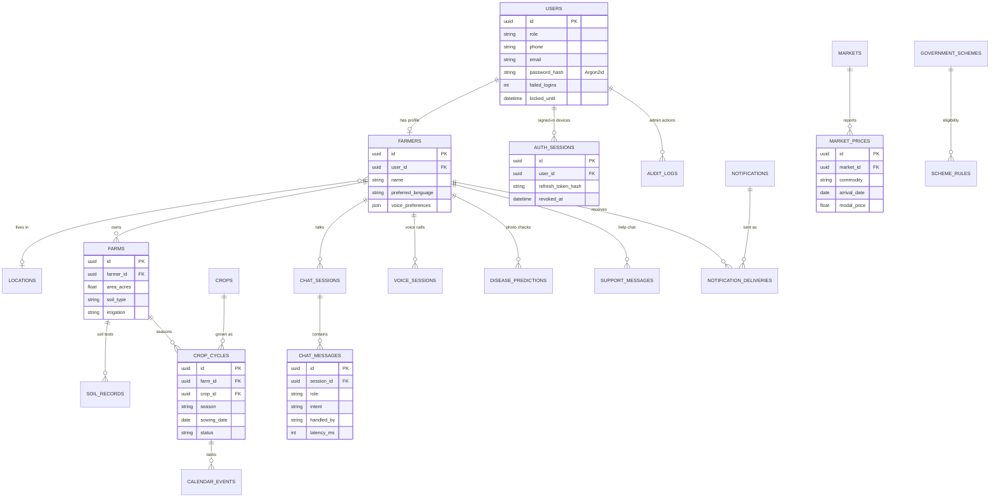

### 3.4 Farmer app screens

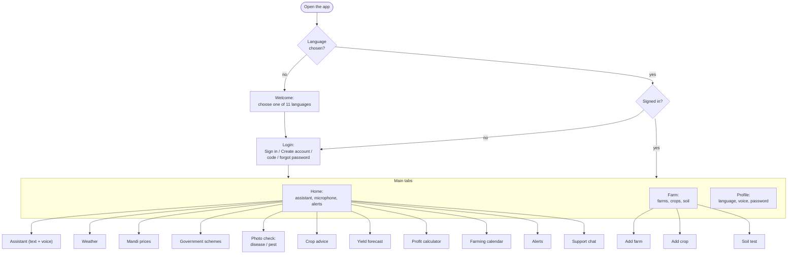

### 3.5 Admin dashboard pages

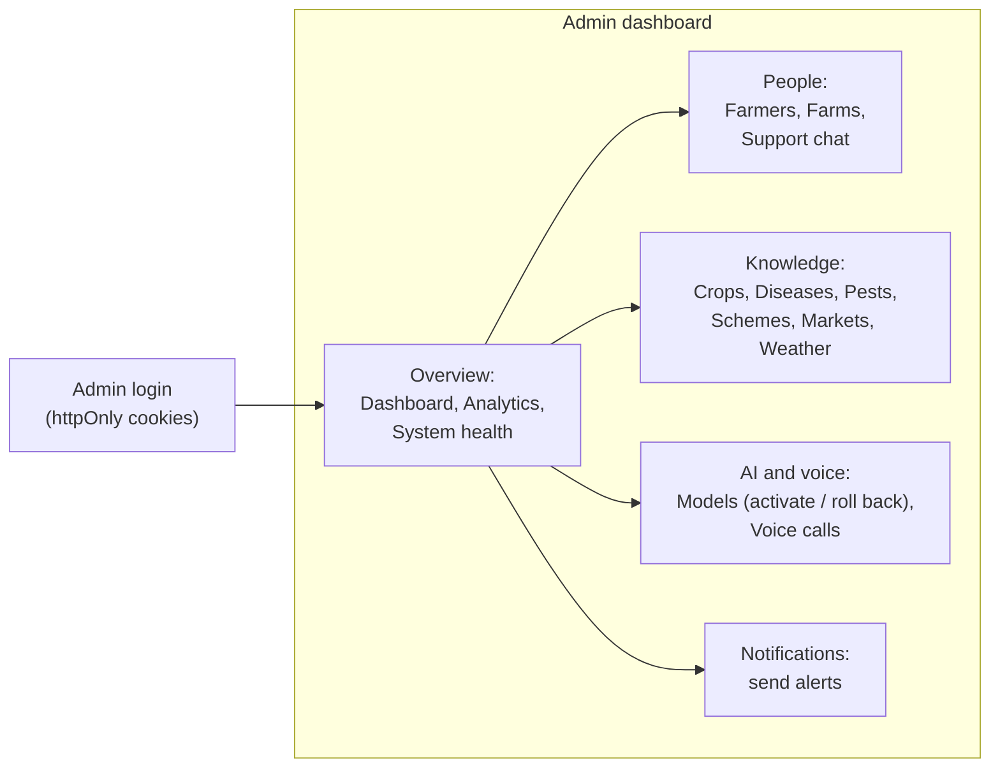

## 4. The AI models: accuracy and worst case

All figures below are read from the model files in `ml/artifacts/*/metadata.json` and
`robustness_*.json`, produced by the training notebooks. They are measured on a held-out test
split. **A held-out split is not the same as truly new data**, and a 99 % score on it should not
be read as 99 % in a farmer's field. Section 4.3 re-tests every model on harder, unseen
conditions and gives the honest picture.

### 4.0 How the models are built, tested and served

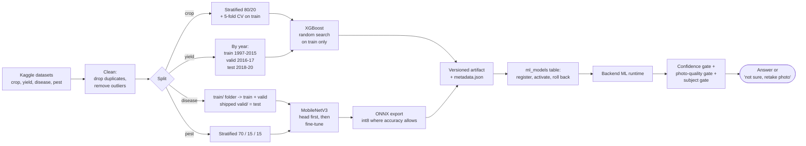

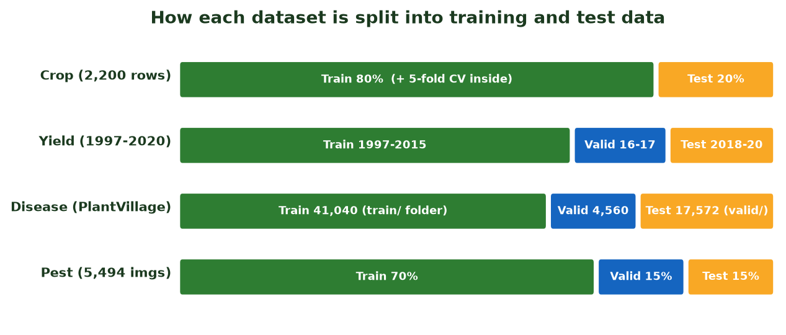

### 4.1 Summary

| Model | Algorithm | Test set | Headline result |
|---|---|---|---|
| Crop recommendation `crop_v3` | XGBoost classifier, 22 crops | 440 rows | **99.55 %** accuracy, macro-F1 0.9955, top-3 **100 %**, 5-fold CV 99.26 % ± 0.43 |
| Yield prediction `yield_v3` | XGBoost quantile regression (P10 / P50 / P90) | 1,110 rows, years 2018-2020 | R² **0.907**, MAE 1.51 t/ha, median error 14.4 % (mean error 21.6 %), 78.5 % of real yields fall inside the P10-P90 band |
| Disease `disease_v1` | MobileNetV3, ONNX int8 (4.9 MB) | 17,572 images | **99.79 %** reported (98.9 % re-measured on the served int8 model, 98.1 % on photos never seen in training), macro-F1 0.9978 |
| Pest `pest_v1` | MobileNetV3-Large, ONNX fp32 | 825 images | **93.21 %** accuracy, macro-F1 0.9283, top-3 97.82 % |
| Subject gate `subject_v1` | MobileNet, ONNX | held-out set | 96.26 % accuracy; keeps 95.8 % of real subjects, rejects 96.6 % of non-plants |

How the results should be read:

* **Crop**: the dataset is clean (soil and climate ranges per crop), so near-perfect accuracy
  is expected. Real farms are messier; this is why the regional prior and agronomic rules sit
  on top of the model.
* **Yield**: the test set is the *latest three years*, never mixed with training years
  (1997-2015), so this measures forecasting, not memorising. The raw P10-P90 band covered only
  57.8 % of outcomes, so it was **widened by a calibration factor of 1.75**, giving 78.5 %.
  It is still slightly under the 80 % ideal, and the app presents it as a range, not a promise.
* **Disease**: PlantVillage-style photos are taken on plain backgrounds, so 99.8 % is the
  *best case*. See the worst case below.
* **Pest**: with the confidence threshold of 0.6, the model answers 88.7 % of photos and is
  **97.4 % correct on the ones it answers**; the rest get "not sure, take a clearer photo".
* **Quantisation**: disease runs int8 (99.5 % against 100 % for fp32 on the check set, 3.5x
  smaller). Pest stays fp32 because int8 dropped it from 91.5 % to 70.5 %.

### 4.2 Worst case: damaged and unexpected photos

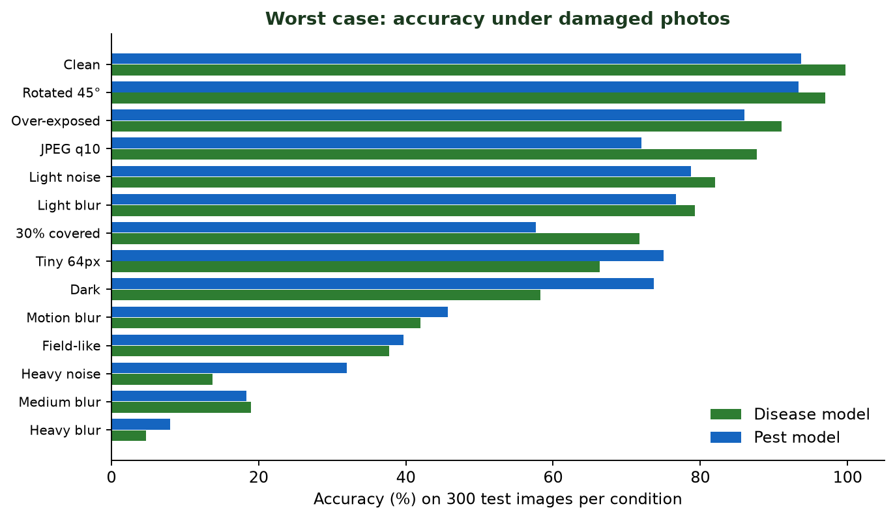

300 test images each, with the model's real confidence threshold applied
(`robustness_disease.json`, `robustness_pest.json`). "Wrong and accepted" is the dangerous
case: the model is wrong *and* answers anyway.

| Photo condition | Disease accuracy | Disease wrong & accepted | Pest accuracy | Pest wrong & accepted |
|---|---|---|---|---|
| Clean | 99.7 % | 0.3 % | 93.7 % | 2.0 % |
| Rotated 45° | 97.0 % | 2.7 % | 93.3 % | 2.0 % |
| Over-exposed | 91.0 % | 5.3 % | 86.0 % | 2.7 % |
| JPEG quality 10 | 87.7 % | 5.0 % | 72.0 % | 5.0 % |
| Light noise | 82.0 % | 9.0 % | 78.7 % | 2.7 % |
| Light blur | 79.3 % | 8.7 % | 76.7 % | 8.0 % |
| 30 % of the leaf covered | 71.7 % | 9.3 % | 57.7 % | 9.0 % |
| Tiny image (64 px) | 66.3 % | 15.7 % | 75.0 % | 4.7 % |
| Dark (0.3x brightness) | 58.3 % | 7.7 % | 73.7 % | 7.7 % |
| Motion blur | 42.0 % | 25.0 % | 45.7 % | 11.3 % |
| Field-like (mixed damage) | 37.7 % | 16.3 % | 39.7 % | 5.7 % |
| Heavy noise | 13.7 % | 42.3 % | 32.0 % | 8.0 % |
| Medium blur | 19.0 % | 35.0 % | 18.3 % | 12.3 % |
| **Heavy blur (worst)** | **4.7 %** | **71.7 %** | **8.0 %** | **5.7 %** |

**Plain statement of the worst case:** with a badly blurred photo the disease model is right
only 4.7 % of the time and, because it still answers, is confidently wrong 71.7 % of the time.
The pest model is more cautious (it refuses most bad photos) but is still right only 8 %.

Off-topic photos (things the model was never trained on) are accepted by mistake as follows,
**before** the subject gate is applied:

| Input | Disease false-accept | Pest false-accept |
|---|---|---|
| Photo of something else | 33 % | 52 % |
| Random noise | 84 % | 0 % |
| Flat colour | 50 % | 49 % |
| Gradient | 99 % | 8 % |
| Heavily blurred other photo | 48 % | 1 % |

What the app does about it: the subject gate, the confidence threshold, a "take a clearer
photo" message, and a recorded diagnosis flagged `accepted` or `uncertain` for admin review.
**A diagnosis is advice, not a verdict**; the farmer should confirm with an agriculture
officer before spraying.

### 4.3 Validation on truly unseen data

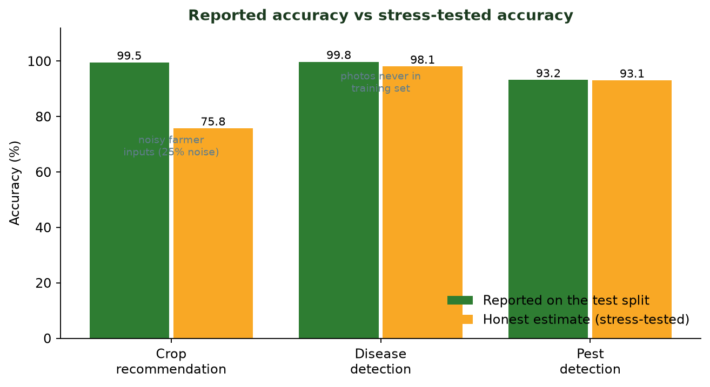

A high test score can hide leakage, an easy dataset, or a model that only learned the
average. These checks (scripts in [ml/checks/](ml/checks)) were run on the real datasets and the
served models.

#### Crop recommendation (reported 99.55 %)
| Test | Result | Meaning |
|---|---|---|
| Plain random split | 99.3 % | Reproduces the reported figure |
| **Simple baselines** (no boosting) | k-nearest-neighbour **98.0 %**, logistic regression **97.3 %** | The dataset is easy: 22 crops x exactly 100 rows with well-separated soil and climate ranges. XGBoost is not doing anything magical |
| Hold out each crop's most atypical 20 % | 98.9 % | Handles unusual rows of known crops |
| Hold out a whole climate band (coldest / hottest 20 %, driest / wettest, least / most humid) | 97.1 % to 100 % | Extrapolates sensibly to new weather |
| **Noisy inputs** (farmers estimate N, P, K, pH; cheap sensors) | noise = 10 % of normal spread: **94.6 %**; 25 %: **75.8 %**; 50 %: **52.2 %**; 100 %: **27.4 %** | **The real weakness.** Accuracy falls fast when inputs are guesses |
| **Nonsense input** (negative temperature, pH 14, N = 500) | still names a crop, once with 84 % confidence (apple) | The model has no "I don't know". The API therefore validates input ranges and applies agronomic rules on top |

Reading: on clean soil-test numbers the model is reliable, but the dataset is idealised (every
crop has a tidy range). Expect **well below 99 %** when the farmer types estimated values,
which is why the app combines the model with a regional prior and rules.

#### Yield prediction (reported R² 0.907)
| Test | Result | Meaning |
|---|---|---|
| Unseen future years (2018-2020) | R² 0.91, MAE 1.51 t/ha, median error 14.4 %, **mean error 21.6 %**, 62 % of forecasts within 20 % of the truth, 92 % within 50 % | The honest headline. (The stored "MAPE 14.44 %" was really the *median*; this is now corrected in the code and the model file) |
| **Baseline: median yield of that crop in that state** | R² 0.92, MAE 1.47 t/ha | **The model does not beat this simple baseline** |
| Baseline: median yield of the crop only | R² 0.70, MAE 2.95 | The state matters a lot, and the model captures that |
| Remove rainfall, fertiliser and pesticide | R² 0.85 with year + crop + state only, versus 0.82 with every feature | **Rainfall, fertiliser and pesticide add no skill** in this dataset |
| R² without sugarcane, banana, potato, onion | **0.62** | The 0.91 is flattered by a few crops with very large yields |
| Hardest crops (mean error) | onion 45 %, moth bean 89 % (11 test rows), bajra 29 %, chickpea 28 % | Treat these forecasts with extra caution |
| **Completely unseen state** (6 states held out) | median error **31 %**, only **36 %** within 20 %; average R² negative because of Meghalaya | The model does **not** transfer to a new region |
| **Completely unseen crop** | median error **45 %**, 19 % within 20 % | It cannot forecast a crop it was not trained on |

Reading: this is a *historical-pattern* model. It is useful for a crop and state it knows, as a
range, and weak where it has no history. It does not respond to a farmer's own fertiliser or
rainfall, so do not present it as a "what if I add more fertiliser" tool.

#### Disease detection (reported 99.79 %)
| Test | Result | Meaning |
|---|---|---|
| **Leakage found** | 61.8 % of the "untouched" test files are rotated or flipped copies of a photo that is in the training set | The test set is not independent |
| Served int8 model, random 3,000 test files | **98.9 %** | The reported 99.79 % is for the larger model before int8 compression |
| Only test photos whose source photo was never in training | **98.1 %** (answers 99.3 % of photos, correct on 98.5 % of those) | A fairer in-dataset number |
| Weakest classes (clean photos) | tomato leaf mold 89 %, potato late blight 90 %, tomato late blight 92 %, spider mites 93 % | Look-alike diseases are confused with each other (spider mites vs target spot, late vs early blight) |
| Blurry, dark, noisy or cluttered photos | see section 4.2: down to **4.7 %** | The big gap |

Reading: inside the PlantVillage dataset the model really does generalise (98 %), but the dataset
is leaf-on-plain-background photos taken in a lab. **Real field photos were not available to
test here**, and the synthetic "field-like" test (mixed damage and clutter) gives only about
38 %. Treat 98 % as an upper bound, not an expectation, until real field photos are collected
and tested.

#### Pest detection (reported 93.2 %)
A near-duplicate check (perceptual hash) between its training and test images found only 4 of
825 test images with a lookalike in training, and accuracy is the same with or without them
(**93.1 %**). The figure is honest for this dataset; its worst-case behaviour is in 4.2.

#### Summary of what to believe
| Model | Reported | Best honest estimate for new, realistic data |
|---|---|---|
| Crop recommendation | 99.55 % | 97 % on clean soil values, **75 % or less if inputs are estimated** |
| Yield | R² 0.91 | Median error about 14 % for a known crop and state; **30-45 % for unseen states or crops** |
| Disease | 99.79 % | 98 % on lab-style photos; **likely far lower in the field (not measured)** |
| Pest | 93.2 % | 93 % on clean photos; lower on poor photos |

### 4.4 Honest limits of the numbers

* Disease and pest figures come from public lab-style datasets. Real field photos are harder
  (the "Field-like" row above: about 38-40 % accuracy). More field images are the single
  biggest improvement available. Retrain the disease model with a split by source photo, not by
  file, so rotated copies cannot sit on both sides.
* Disease covers 38 classes (14 crops, including many non-Indian ones such as apple and
  blueberry). Crops outside the list, including rice and wheat, are not recognised.
* The pest model identifies insect *type*, not crop damage.
* Each model is versioned (`crop_v1..v3`, `yield_v1..v3`) and an admin can activate or roll
  back a version without redeploying.

## 5. Voice and native-language support

### Languages
11 languages, each with a complete translation file in both the app (357 keys) and the
backend (104 keys); every language has exactly the same keys as English. The farmer's
language is stored on their profile and used for text, speech and alerts. Intent detection
uses a keyword list per language (`backend/app/assistant/lexicons`).

### Speech pipeline
```
 microphone -> app records (max 30 s) -> POST /voice/session/{id}/utterance
   -> speech-to-text (Sarvam, else Gemini; local Whisper is another option)
   -> AgriBrain (NLU rules -> tool / ML model / database -> reply text in the farmer's language)
   -> text-to-speech (male or female voice) -> audio back to the app
```
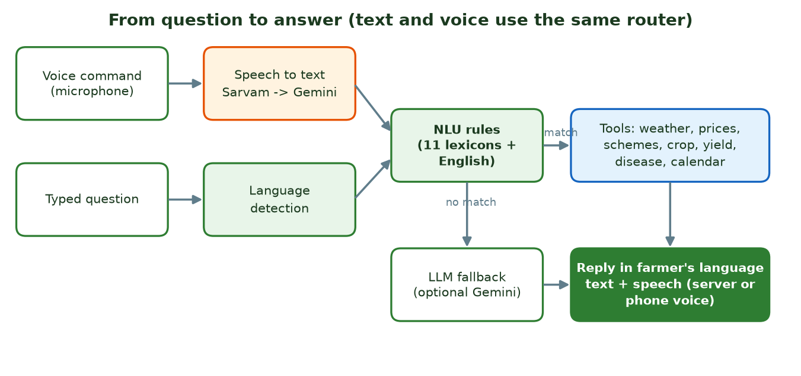

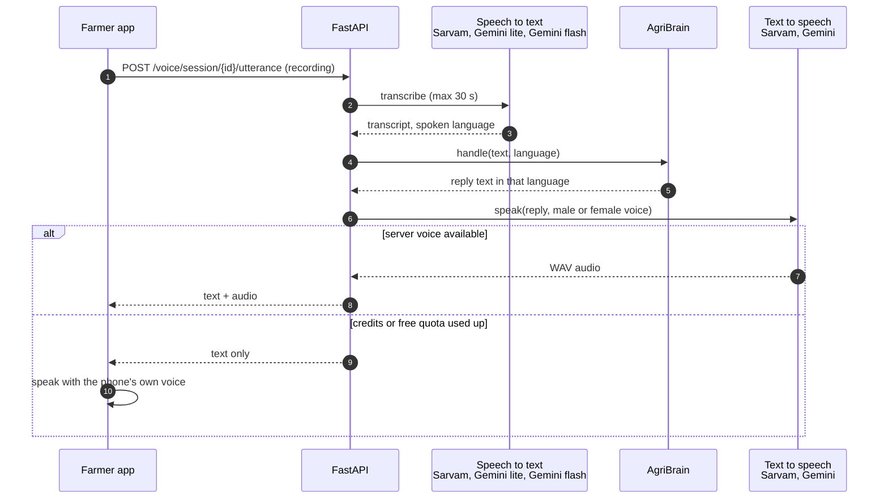

* If server speech is unavailable the app falls back to the phone's own text-to-speech.
* `GET /voice/capabilities` tells the app what the server can do, so buttons only appear when
  they will work.
* Voices are listed by `GET /voice/voices`; the farmer's choice is saved.
* Provider order and backup are set in `.env`: `VOICE_PROVIDER` (sarvam / bhashini / local /
  none) and `VOICE_FALLBACK_PROVIDER` (gemini).

### Measured results (20 October 2026, real providers, [backend/loadtest/language_voice_check.py](backend/loadtest/language_voice_check.py))
Each language gets a new farmer account, three typed questions (weather, onion price, government
schemes), a spoken reply, and two real voice commands (the question is spoken with text-to-speech,
uploaded as a recording, recognised, answered and spoken back).

| Step | Result |
|---|---|
| Typed question -> correct answer type, in the same language | **33 of 33** (11 languages x 3 questions) |
| Reply written in the farmer's own script | All 11. Price answers are about 70 % native script because live market names ("Myladi (Uzhavar Sandhai)") come from the government feed in English |
| Voice command -> text (speech recognition) | **17 of 17** that could be tested, similarity 0.92 to 1.00 to what was said (English, Hindi, Telugu, Tamil, Kannada, Malayalam, Marathi, Bengali, Gujarati) |
| Voice command -> correct answer type | **17 of 17** |
| Text -> speech (server voice) | Works for English, Hindi, Telugu, Tamil, Kannada, Malayalam, Marathi, Bengali, Gujarati |
| **Not verified** | Punjabi and Odia speech: the free Google quota ran out during the test, so no test audio could be made. Their typed answers work (3 of 3 each) |

Speed: a typed answer takes under 0.1 s, except prices (about 4 s, live government feed). A spoken
question takes 2.5 to 20 s end to end (recognise, look up, speak), mostly the speech services.

**What "free" means for voice, honestly**
* **Typing always works** in all 11 languages and costs nothing.
* **Voice commands** use Google Gemini (free key from aistudio.google.com). It recognised every
  language tested. Its free tier has daily limits, so heavy use needs a paid plan.
* **Spoken replies:** Google's free tier allows only **10 speech requests per day per model**, which
  a real deployment uses up in minutes. When the server has no voice, the app speaks the answer
  with the **phone's own text-to-speech** (free, unlimited, works offline). Quality and the languages
  available depend on the phone's installed voices (Android: Settings -> Language -> Text-to-speech).
* **Sarvam** (best Indian voices, paid) is optional. When its credits run out the system switches
  to Gemini by itself, and to the phone voice after that. To run entirely free, set
  `VOICE_PROVIDER=gemini` and leave `SARVAM_API_KEY` empty.
* Speech recognition now tries the fast Gemini lite model first (1.5 s) because the full model
  stalled for 30 s or more on audio, which used up the 25 s time limit.

### Phone call (no smartphone needed)
Twilio sends the call to `POST /voice/telephony/twilio/incoming`. The request signature is
verified (HMAC-SHA1), the media stream carries a signed token, concurrent calls are capped
(`MAX_CONCURRENT_CALLS`, default 20) and each call is limited to `MAX_CALL_SECONDS`
(default 600). The worker can also place outbound alert calls with signed, expiring audio
links.

## 6. Algorithms and design choices

| Area | Algorithm / technique | Why |
|---|---|---|
| Crop advice | XGBoost (800 trees, depth 8) x regional prior x agronomic rules, ranked over the whole crop catalogue | Soil fit alone ignores what actually grows locally |
| Yield | XGBoost quantile regression on log1p(yield), with interval calibration | Gives a range, and handles skewed yields |
| Image models | MobileNetV3 transfer learning (head then fine-tune), exported to ONNX, optional int8 | Small and fast on CPU |
| Photo safety | Subject gate + confidence threshold + accepted / uncertain flag | Avoid confident wrong answers |
| Intent detection | Rule-based NLU with per-language lexicons (data, not code), always merged with English | Fast, free, predictable, handles code-mixing |
| Conversation | Router: rules -> LLM intent fallback -> LLM chat; keeps the last 6 turns | LLM only when needed |
| Multi-topic questions | Up to 2 distinct topics answered in one reply | "Weather and price of rice" |
| Voice provider choice | Primary -> fallback per task, voice mapped by gender | Survives credit loss or outage |
| Market prices | Fallback provider (Agmarknet -> data.gov.in), 180-minute cache, parallel fetch capped at 4 | Respect upstream limits |
| Upstream back-off | Honour `Retry-After`, else exponential with jitter | Be polite to government APIs |
| Rate limiting | Sliding window per user (or per IP when anonymous) | Fair, bounded memory |
| Model loading | Versioned artifacts; framework-native files only (no pickles) | Loading a model cannot run attacker code |
| Alerts | Idempotent scheduled jobs; deliveries claimed with `FOR UPDATE SKIP LOCKED` | Many workers, no duplicate messages |
| Translation | Cached per language, warmed up by the worker | Low latency |

## 7. Performance, latency and load balancing

### Measured (development PC, 2 October 2026)
Setup: one Windows 11 laptop (16 logical CPUs), local PostgreSQL 16, models `crop_v3`,
`yield_v3`, `disease_v1`, `pest_v1`. Each virtual farmer logs in once and then repeats a
realistic mix (assistant, weather, prices, schemes, crop advice, profile) with about one
second of thinking time. Full method in [backend/loadtest/README.md](backend/loadtest/README.md).

| Setup | Farmers | Requests | Errors | p50 | p95 | p99 |
|---|---|---|---|---|---|---|
| One API instance | 100 | 2,696 | 0 % | 90 ms | 326 ms | 584 ms |
| Caddy, `least_conn`, 3 instances | 100 | 4,409 | 0 % | 23 ms | 71 ms | 106 ms |
| Caddy, 3 instances, 1,000 farmers | 1,000 | 13,182 | 0 % | about 1.8 s | about 7 s | about 11 s |

* At 1,000 farmers the laptop itself is saturated (about 81 % CPU, 3.8 cores spent on the load
  generators). Nothing failed; requests queued and were answered.
* Roughly **45 requests per second per worker**, about 55 active farmers per worker at low
  latency. Capacity grows by adding replicas and workers.
* These are laptop numbers, not a production guarantee. Re-measure on your own server.

### Load balancing
* `deploy/nginx.conf`: `least_conn` upstream (new requests go to the least busy instance),
  64 kept-alive connections to the API, gzip, 8 MB body limit, a per-IP limit of 200 req/s,
  `/metrics` blocked from the internet, and one `X-Request-ID` carried end to end.
* Scale out with `docker compose -f deploy/docker-compose.yml up -d --scale api=4`.
* Health: `GET /health` (process alive) and `GET /ready` (database reachable) for the balancer.
* Database connections are budgeted: `replicas x workers x (DB_POOL_SIZE + DB_MAX_OVERFLOW)`
  must stay below PostgreSQL `max_connections`. If the pool is exhausted the API answers
  **503 `service_busy` with `Retry-After`** instead of crashing.

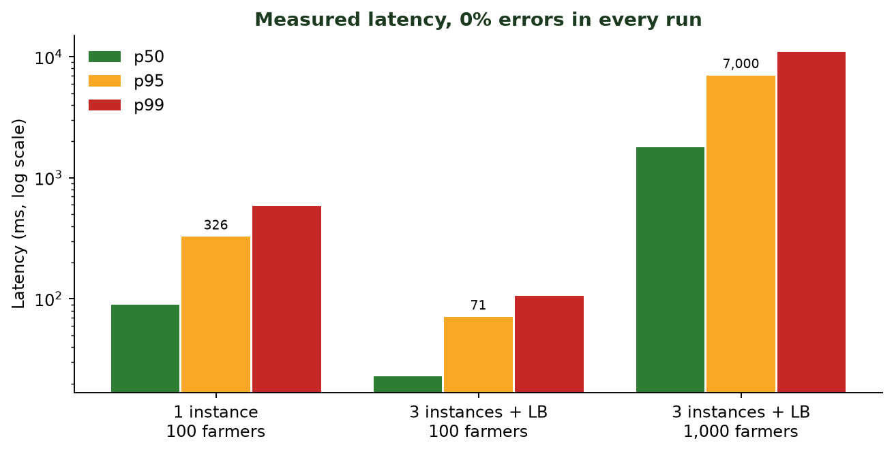

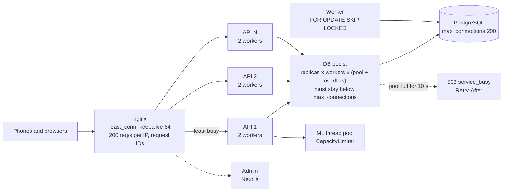

### Latency work that changed the code
* XGBoost was using all CPU cores for a single-row prediction: 54.6 ms CPU versus 7.4 ms
  single-threaded. It is now pinned to one thread (about 4x less CPU per request).
* Weather is cached 30 minutes, prices 3 hours, translations permanently.
* int8 quantisation shrinks the disease model from 17.3 MB to 4.9 MB.

## 8. Thread safety and concurrency

* **Async I/O** on one event loop; CPU-heavy work (model inference, image decoding) runs on a
  **bounded thread pool** (`ML_MAX_CONCURRENCY`, default 4) using `anyio.CapacityLimiter`.
  Extra requests wait their turn rather than overloading the CPU. NumPy, XGBoost and ONNX
  Runtime release the GIL, so this is real parallelism.
* **Model registry**: one `asyncio.Lock` per model, so a model is loaded exactly once even
  when many requests arrive together.
* **Rate limiter**: a `threading.Lock` guards the sliding-window table; memory is capped at
  100,000 keys with eviction.
* **Database**: row locks (`SELECT ... FOR UPDATE`) protect one-time codes and refresh-token
  rotation, so a code or token cannot be used twice by two simultaneous requests. The worker
  uses `FOR UPDATE SKIP LOCKED`, so several workers never send the same notification.
* **External calls**: semaphores cap parallel calls to Sarvam, Agmarknet and myScheme, and cap
  simultaneous phone calls.
* **Stateless API**: no per-user data lives in process memory except caches and the
  in-process rate limiter, so instances can be added or removed freely. Security-critical
  limits (OTP requests) are enforced in PostgreSQL so they hold across instances.

## 9. Security

| Area | What is done |
|---|---|
| Passwords | Argon2id hashing (never stored or logged in plain text); at least 8 characters; a dummy hash is checked for unknown accounts so login time does not reveal which accounts exist |
| Brute force | 5 wrong passwords lock the account for 15 minutes (stored in the database, so it holds across servers), plus a per-IP rate limit (10 sign-ins a minute) |
| Forgot password | One-time code (6 digits, 5 minutes, 5 attempts, single use, stored hashed); a reset signs out every other device |
| Same password everywhere | The password is checked against the one database row, so the phone app, the Expo web app and any other client use the same account |
| Tokens | Short-lived access token (30 minutes, HS256) and rotating refresh token (30 days) stored hashed on the server; logout revokes it |
| Authorisation | Role checks (farmer / admin); a farmer token gets 403 on admin routes |
| Rate limits | Per-user or per-IP sliding window (60 / min general, 20 / min assistant, 5 / min admin login) |
| Input validation | Pydantic on every request; phone numbers normalised to `+91XXXXXXXXXX` |
| Uploads | Only JPEG / PNG / WebP, size limits, decompression-bomb guard (40 MP) |
| Models | Framework-native artifacts only; no `pickle` loading |
| Headers | `nosniff`, `X-Frame-Options: DENY`, `no-referrer`, HSTS |
| Production mode | API docs hidden; refuses to start with the console SMS provider |
| Telephony | Twilio signature verified; stream tokens signed; audio links signed and expiring |
| Secrets | Only in environment variables; `.env` is git-ignored; the mobile app holds no third-party keys, it only talks to the AgriSmart API |
| Device storage | On phones, tokens are kept in the OS secure store (Expo SecureStore). The web build has no keystore and uses browser localStorage |
| Proxy trust | The client IP is taken only from the load balancer, never from a user-supplied header |
| Audit | Admin actions are written to an audit log |
| Observability | Request IDs, structured logs, metrics |

### Sign-in and token flow

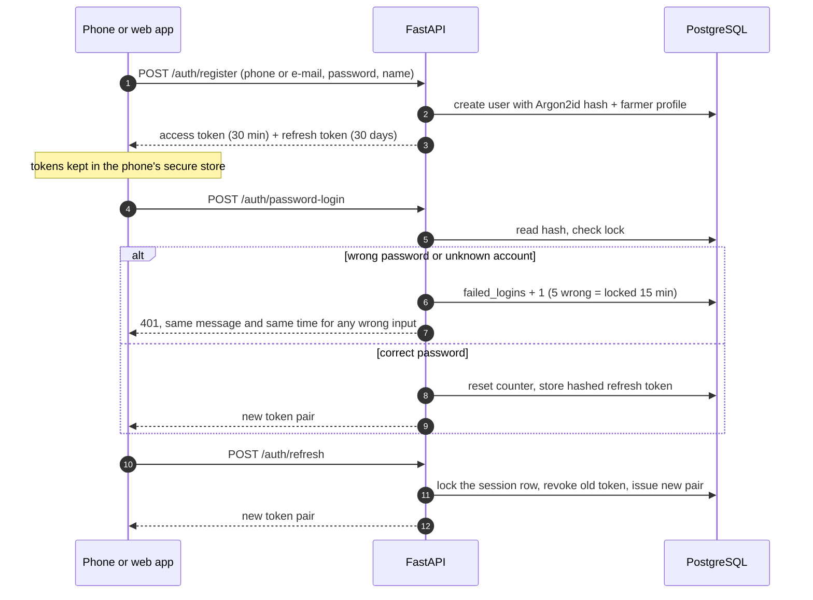

## 10. Run everything locally

**You need:** Windows 10/11 (for the one-click script) or any OS (manual steps), Python 3.12+,
Node.js 20+ with npm, and a phone with **Expo Go** if you want to test on a real device.

### 10.1 Backend (API + database)

```powershell
cd backend
python -m venv .venv
.venv\Scripts\python -m pip install -e .
copy .env.example .env
```

Edit `backend\.env`. Minimum: set `JWT_SECRET` (generate with
`python -c "import secrets; print(secrets.token_urlsafe(48))"`) and `DATABASE_URL`.

Database, either:
* **Installed PostgreSQL 16 or Docker**: create a database `agrismart` and keep the default
  `DATABASE_URL` from `.env.example`; or
* **No install**: `start-all.ps1` starts a bundled PostgreSQL (the `pgserver` package) for you.

```powershell
.venv\Scripts\alembic upgrade head                              # create tables
.venv\Scripts\python -m app.cli seed                            # crops, schemes, reference data
.venv\Scripts\python -m app.cli create-admin you@example.com    # asks for a 12+ character password
.venv\Scripts\uvicorn app.main:app --host 0.0.0.0 --port 8000
```

(`python -m app.cli bootstrap` does the seed, model registration and admin creation in one go;
it reads `BOOTSTRAP_ADMIN_EMAIL` and `BOOTSTRAP_ADMIN_PASSWORD` from `.env`.)

Check it: open http://127.0.0.1:8000/docs (interactive API) and http://127.0.0.1:8000/ready
(should say `{"status":"ready","database":"up"}`).

In a second window start the **worker** (alerts, price refresh, scheme sync):

```powershell
.venv\Scripts\python -m app.worker
```

### 10.2 Train or add the models

Weights and datasets are not stored in git (they are large). Without them the API still
starts, but the prediction endpoints cannot answer.

```powershell
cd ml
python -m venv .venv
.venv\Scripts\python -m pip install -r requirements.txt
# download the four Kaggle datasets into ml\data\archives (names in ml\README.md), then:
.venv\Scripts\python -m agrismart_ml.datasets
```

Run the notebooks in `ml\notebooks` in order (01 crop, 02 yield, 03 disease, 04 pest). Each
writes a versioned folder under `ml\artifacts`. Set `MODEL_DIR=../ml/artifacts` in
`backend\.env`, then register and activate a version:

```powershell
cd backend
.venv\Scripts\python -m app.cli register-model crop crop_v3 --activate
```

The subject gate and robustness checks are `ml\train_gate.py` and `ml\eval_robustness.py`.
Full detail: [ml/README.md](ml/README.md).

### 10.2b Passwords and accounts (free, stored in the database)

* **Farmers** open the app and choose **Create account**: phone number or e-mail, name and a
  password (8+ characters). Next time, **Sign in** with the same number and password, on the phone
  or in the browser. **Profile -> Password** changes it, or sets one for an account that was made
  with a code.
* **Admins** are created on the server, and the same password works on the admin website:
  `python -m app.cli create-admin you@example.com`
* **Lost a password?** Farmers use **Forgot password** (needs the optional code service); you can
  always reset any account from the server:
  `python -m app.cli set-password you@example.com` (or `+919876543210`).
* The password is saved only as an Argon2id hash in the `users` table. Check it with
  `select phone, left(password_hash, 22) from users;` (you will see `$argon2id$v=19$m=65536`).
* Trade-off to know: with no SMS, nobody proves they own a phone number when registering. The first
  person to register a number owns that account. Turn on Twilio or SMTP and require a code at
  registration if this matters for your deployment.

### 10.3 Farmer app (mobile)

```powershell
cd mobile
npm install
$env:EXPO_PUBLIC_API_URL = "http://<your-PC-LAN-IP>:8000"   # NOT localhost, for a real phone
npx expo start --lan
```

Scan the QR code with **Expo Go** (Android) or the Camera app (iPhone). The phone and PC must
be on the **same Wi-Fi**, and Windows Firewall must allow ports 8000 and 8081. Find your LAN IP
with `ipconfig` (the IPv4 address of your Wi-Fi adapter).

If you forget to set the address, you can type the server address on the sign-in screen
(**Server**) and it is remembered.

### 10.4 Admin dashboard

```powershell
cd admin
npm install
$env:AGRISMART_API_URL = "http://127.0.0.1:8000"
npm run dev            # http://localhost:3000   (or: npm run build; npx next start -p 3000)
```

Sign in with the admin e-mail and password you created in 10.1.

### 10.5 One command (Windows)

```powershell
powershell -ExecutionPolicy Bypass -File .\start-all.ps1
```

Starts the database, API (8000), worker, admin (3000) and Expo (8081) in separate windows and
prints the QR code and the address the phone should use. Stop everything with `.\stop-all.ps1`.
It expects `backend\.venv` and `backend\.env` to exist (10.1).

### 10.6 Docker (production-shaped)

```powershell
copy deploy\.env.example deploy\.env        # fill in secrets
docker compose -f deploy/docker-compose.yml up -d --build
docker compose -f deploy/docker-compose.yml up -d --scale api=4
```

## 11. Check it in mobile view

Three ways, from most realistic to easiest.

**A. Real phone with Expo Go.** Follow 10.3.

**B. Browser in phone shape (no phone needed).**
```powershell
cd mobile
$env:EXPO_PUBLIC_API_URL = "http://127.0.0.1:8000"
npx expo start --web --port 8081
```
Open http://localhost:8081 in Chrome or Edge, press **F12**, then **Ctrl+Shift+M** (device
toolbar) and choose a phone such as "Pixel 7" or "iPhone 14". The microphone and camera ask
for browser permission.

**C. Android emulator.** Install Android Studio, create a virtual device, run
`npx expo start` and press **a**.

**Test checklist**
1. Choose **Create account** (phone number, name, password), close the app, reopen it and
   **Sign in** with the same password. Then open the same account in the web version.
2. Change the language: every screen's text should change.
3. Assistant tab: ask about the weather by typing, then by voice.
4. Diagnose: photograph a leaf; try a blurry photo and confirm it says it is not sure.
5. Market: pick a crop and see live prices. Schemes: see the eligible schemes.
6. Profile: change language and voice, close and reopen the app, confirm they are kept.

## 12. Install on a phone (APK)

No APK is published in this repository. Build your own (free), then share the file or upload
it to **GitHub -> Releases** and link it here.

### Option 1: EAS cloud build (easiest, free tier)
```powershell
npm install -g eas-cli
cd mobile
eas login
eas build -p android --profile preview      # produces a downloadable .apk
```
1. First open `mobile/eas.json` and change `EXPO_PUBLIC_API_URL` under `preview` to **your**
   deployed API address (https). The APK talks to that server.
2. When the build finishes, EAS prints a link and a QR code to the `.apk`.

### Option 2: Build locally
Needs Android Studio (SDK) and JDK 17.
```powershell
cd mobile
$env:EXPO_PUBLIC_API_URL = "https://your-api.example.com"
npx expo prebuild --platform android
cd android; .\gradlew assembleRelease
# APK: android\app\build\outputs\apk\release\app-release.apk
```

### Installing the APK on a phone
1. Send the `.apk` to the phone (download link, USB cable, or a messaging app).
2. Open it. If asked, allow **Install unknown apps** for that app (Settings -> Apps -> Special
   access).
3. Tap **Install**, open **AgriSmart**, and allow microphone, camera and location when asked.

Package name `in.agrismart.app`, version 1.1.0 (versionCode 2). For the Play Store use the
`production` profile (it builds an `.aab`).

## 13. Admin dashboard (website)

Next.js app in `admin/`. Pages: Dashboard, Analytics, Farmers, Farms, Crops, Diseases, Pests,
Markets, Schemes, Weather, Notifications, Support (chat with farmers), Voice calls, Models
(activate or roll back a model version), System health.

* Local: see 10.4.
* Production: deploy `admin/` to Vercel (root directory `admin`, environment variable
  `AGRISMART_API_URL=https://your-api`), or run the Docker image (`admin/Dockerfile`).
  Sign in with the e-mail and password created by `python -m app.cli create-admin`.
* The API must list the admin's address in `CORS_ORIGINS`.

## 14. Deploy

| Piece | Option | Notes |
|---|---|---|
| Whole stack on one server | `deploy/docker-compose.yml` + nginx | Scales with `--scale api=N` |
| Free tier | [deploy/free/README.md](deploy/free/README.md): Supabase (database), Hugging Face Space (API), Vercel (admin), EAS (APK) | Free tiers sleep when idle, so the first request can be slow |

Before going live set: `ENVIRONMENT=production`, a strong `JWT_SECRET`, `CORS_ORIGINS`,
`PUBLIC_BASE_URL`, and the provider keys you use. Password sign-in needs no paid service. If you
choose `SMS_PROVIDER=twilio` or `EMAIL_PROVIDER=smtp`, their settings must be complete or the app
refuses to start. `DEMO_LOGIN=true` is for demos only: it shows sign-in codes to everyone.

### Deployment options

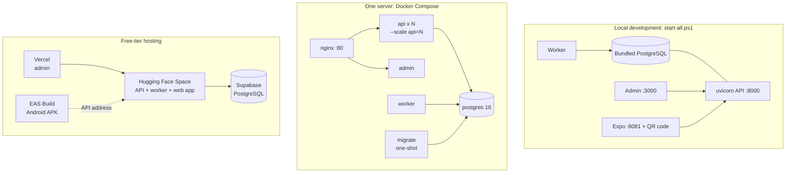

## 15. Testing

```powershell
cd backend;  .venv\Scripts\python -m pytest          # 234 tests (API, password sign-in, voice, NLU, markets, telephony)
cd mobile;   npm run typecheck; npm run lint
cd admin;    npx tsc --noEmit; npx eslint src
cd ml;       python -m pytest tests                  # model contract tests
cd ml;       .venv\Scripts\python checks\crop_check.py   # also yield_check.py, disease_leak.py, pest_leak.py (unseen-data tests)
cd backend;  python -m loadtest.loadtest --url http://127.0.0.1:8000 --users 100 --duration 45
```

## 16. Repository layout

| Folder | What it is |
|---|---|
| [backend/](backend) | FastAPI API and worker: auth, farms, ML inference, market, schemes, voice, notifications |
| [mobile/](mobile) | Expo / React Native farmer app (Expo Go, APK and web) |
| [admin/](admin) | Next.js admin dashboard |
| [ml/](ml) | Training notebooks, evaluation scripts and the `agrismart_ml` package |
| [deploy/](deploy) | Docker Compose, nginx and free-tier setup |
| [legacy/](legacy) | The earlier prototype, kept for reference only |

## 17. Known limits (read this)

* Image models are **weak on bad photos** (section 4.2). Show the farmer the result as advice
  and ask for a clearer photo when unsure.
* Disease classes include many non-Indian crops; rice and wheat disease detection is **not**
  covered by `disease_v1`.
* The yield range is slightly under-confident (78.5 % coverage against an 80 % target), and the
  model barely beats a "median of that crop in that state" lookup. It does not use rainfall,
  fertiliser or pesticide in any useful way.
* The crop model has no "unknown" answer and loses accuracy quickly on estimated inputs.
* Load figures are from one laptop. Production capacity depends on your hardware.
* Free hosting sleeps when idle. `deploy/free/README.md` lists addresses used during
  development; they are not guaranteed to be online.
* The in-process rate limiter is per instance; the OTP limit is global because it is stored in
  PostgreSQL. Use Redis if you need exact global limits for every route.
* Have a native speaker review important wording in each language, especially safety advice
  such as pesticide use.
* Voice quality and availability depend on Sarvam and Gemini accounts and credits.

## 18. Licences and data sources

* Code: add your own licence file at the repository root before publishing (`mobile/LICENSE`
  is Expo's template licence, not a licence for this project).
* Training data (Kaggle): Crop Recommendation, Crop Yield in Indian States, New Plant Diseases
  Dataset, Agricultural Pests Image Dataset. Each keeps its own licence; check them before
  redistributing trained models.
* Live data: Open-Meteo (weather), Agmarknet and data.gov.in (mandi prices, Government of
  India open data), myScheme (government schemes), and Sarvam, Google Gemini and Twilio
  (voice, language, telephony) under their own terms.
* Never commit API keys. Copy `.env.example` to `.env` and keep `.env` private.
