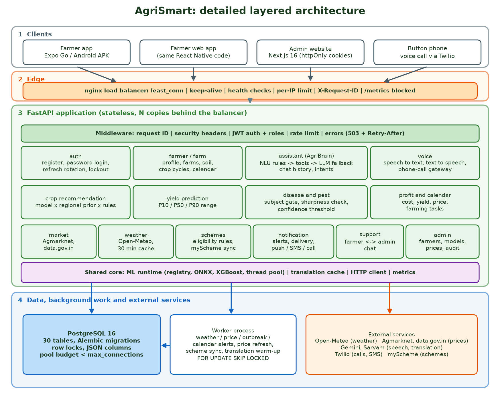
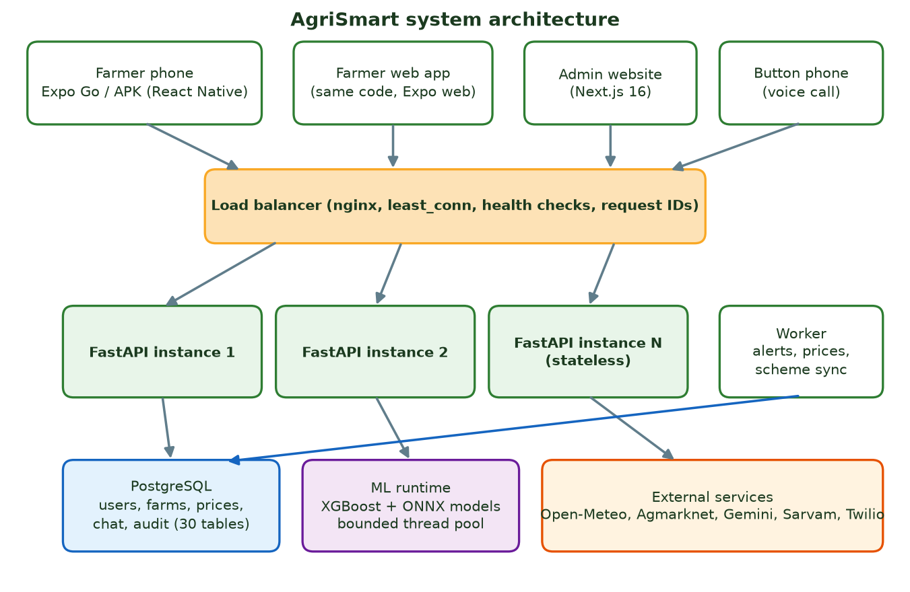
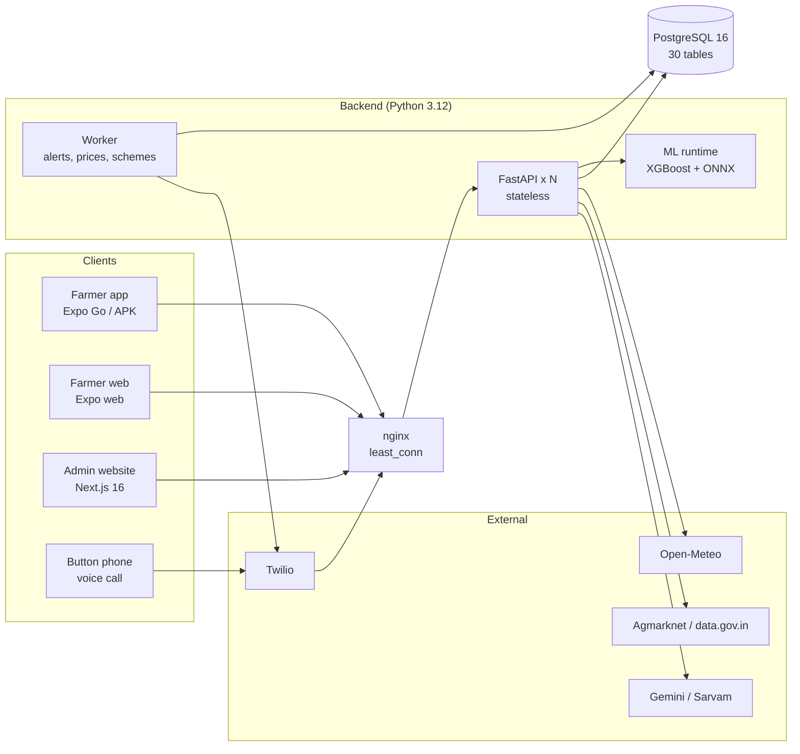
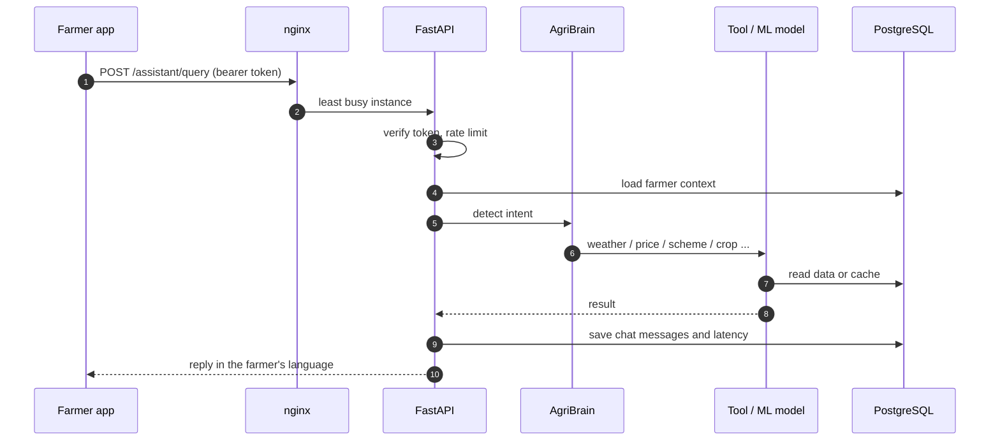

# AgriSmart architecture

A farmer-facing assistant (app, web, voice, phone call) backed by one stateless API, one PostgreSQL
database, four ML models and a background worker. This page is the architecture reference; the
README has setup and results, and [AgriSmart_Project_Documentation.pdf](AgriSmart_Project_Documentation.pdf)
has the full report.

## 1. Layered view

| Layer | What lives there | Key design choice |
|---|---|---|
| 1. Clients | Expo Go / Android APK, farmer web app (same code), Next.js admin site, button phone via Twilio | One React Native codebase for phone and web; admin tokens kept in httpOnly cookies |
| 2. Edge | nginx load balancer | `least_conn` because requests vary from milliseconds to seconds; health checks, per-IP limit, request IDs |
| 3. API | FastAPI, one module per feature, shared middleware and shared core | Stateless, so copies can be added freely; CPU work on a bounded thread pool |
| 4. Data and services | PostgreSQL, worker process, external services | Row locks for tokens and queues; worker claims jobs with `SKIP LOCKED` |

## 2. System overview

## 3. Backend modules

| Module (`backend/app/`) | Responsibility |
|---|---|
| `auth` | Register, password sign-in, refresh-token rotation, lockout, optional one-time codes |
| `farmer`, `farm`, `calendar` | Profile, farms, soil tests, crop cycles, farming tasks |
| `assistant` | AgriBrain: rule-based NLU (11 languages + English), tools, optional LLM fallback, chat history |
| `voice` | Speech to text, text to speech, provider fallback chain, phone-call gateway |
| `crop`, `yield_prediction`, `disease`, `pest`, `profit` | The four models and the profit calculator, with confidence and photo-quality gates |
| `market`, `weather`, `schemes` | Live data with caches and fallbacks |
| `notification`, `support` | Alerts and farmer-to-admin chat |
| `admin` | Dashboard API: farmers, models, prices, audit log |
| `ml` | Model registry, ONNX and XGBoost runtimes |
| `language` | Translation templates and cache |
| `core` | Config, database, security, rate limiting, concurrency, errors, metrics |

## 4. Request flow

## 5. Scaling and failure behaviour

- **More capacity:** `docker compose -f deploy/docker-compose.yml up -d --scale api=N`; nginx re-reads Docker DNS, so no restart is needed.
- **Database protection:** `replicas x workers x (pool + overflow)` must stay below PostgreSQL `max_connections`. A full pool returns `503 service_busy` with `Retry-After`.
- **Provider outage:** speech falls back from Sarvam to Gemini to the phone's own voice; prices fall back from Agmarknet to data.gov.in.
- **Duplicate work:** several workers can run at once; alert deliveries are claimed with `FOR UPDATE SKIP LOCKED` and carry idempotency keys.
- **Measured:** 0% errors from 100 to 1,000 simulated farmers on one laptop (see the README, section 7).
